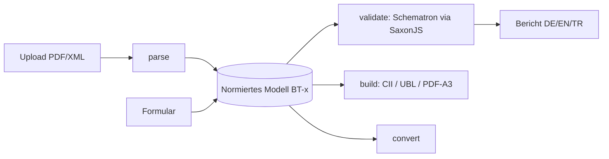

# E-Rechnung Kit · Konzept

Projekt 1 von 10 im Portfolio von Ömer Tiryaki · Stand 16.11.2026

| | |
|---|---|
| Repo | `tirlogy/einvoice-kit` (öffentlich) |
| Demo | erechnung.tiryaki.eu |
| Lizenz | MIT |
| Art | Flaggschiff (mit ausführlicher Fallstudie) |
| CV-Profil | software-web |
| Geschätzte Dauer | 3 bis 4 Wochen |
| Paket | npm: `@tirlogy/einvoice` (Veröffentlichung durch Ömer) |

## Kurzbeschreibung
- **DE:** ZUGFeRD- und XRechnung-Dateien im Browser anzeigen, prüfen, erstellen und konvertieren. Als npm-Paket und Web-App, ohne dass eine Rechnung das Gerät verlässt.
- **EN:** View, validate, create and convert ZUGFeRD and XRechnung e-invoices in the browser. Available as an npm package and a web app, invoices never leave the device.
- **TR:** ZUGFeRD ve XRechnung e-faturalarını tarayıcıda görüntüleyin, doğrulayın, oluşturun ve dönüştürün. npm paketi ve web uygulaması olarak; faturalar cihazdan hiç çıkmaz.

## Warum dieses Projekt
In Deutschland müssen Unternehmen E-Rechnungen seit 2025 empfangen können, ab 2027 bzw. 2028 auch versenden. Kleine Firmen und Freelancer brauchen ein einfaches, datenschutzfreundliches Werkzeug. Das Projekt zeigt Fachwissen (EN 16931, ZUGFeRD, XRechnung, Umsatzsteuer), saubere Bibliotheksarchitektur und ein veröffentlichtes npm-Paket.

## Funktionen (verbindlich)
- **Anzeigen:** ZUGFeRD/Factur-X-PDF (eingebettetes XML extrahieren) oder XRechnung-XML (CII und UBL) hochladen und als gut lesbare Rechnung darstellen, druckbar
- **Prüfen:** offizielle Regelwerke EN 16931 und XRechnung (Schematron, beim Build zu XSLT/SEF kompiliert, Ausführung mit SaxonJS im Browser). Fehler und Warnungen verständlich erklärt (DE/EN/TR), mit Regel-ID und Fundstelle. Hinweis, wenn ein Profil (MINIMUM, BASIC WL) in Deutschland nicht als E-Rechnung gilt
- **Erstellen:** Formular mit Live-Vorschau, dann Download als ZUGFeRD EN 16931 (PDF/A-3 mit eingebettetem XML) oder XRechnung (CII oder UBL)
- **Konvertieren:** XRechnung (CII/UBL) ↔ ZUGFeRD EN 16931, CII ↔ UBL
- **Sonderfälle beim Erstellen:** Kleinunternehmer § 19 UStG, 19 % und 7 %, Reverse Charge § 13b, innergemeinschaftliche Lieferung, Rabatte und Zuschläge auf Positions- und Belegebene, Anzahlungs- und Schlussrechnung, Gutschrift, Storno, Leitweg-ID für öffentliche Auftraggeber
- **Lokal speichern:** Absender, Kunden und Artikel in IndexedDB, Export/Import als JSON, sichtbarer Button „Alle Daten löschen“. Rechnungen selbst werden nicht gespeichert
- Logo-Upload und 2 PDF-Layouts für die Sichtansicht der ZUGFeRD-Rechnung

## Nicht im Umfang
- Server-Verarbeitung von Rechnungen
- Benutzerkonten
- Versand per Mail oder Peppol
- EXTENDED-Profil beim Erstellen (nur Lesen und Prüfen)
- Buchhaltung oder Archivierung (GoBD)

## Architektur
Monorepo (pnpm workspaces):
- `packages/einvoice`: Kernbibliothek ohne UI. Module: `parse` (CII, UBL, ZUGFeRD-PDF), `model` (internes, normiertes Rechnungsmodell nach EN 16931 Business Terms BT-x), `validate` (Schematron via SaxonJS plus eigene Plausibilitätsregeln), `build` (CII-XML, UBL-XML, PDF/A-3), `convert`. Läuft in Browser und Node.
- `apps/web`: Vite + React-App, nutzt das Paket, PWA, i18n DE/EN/TR
- `tools/rules`: Skript, das die offiziellen Schematron-Dateien lädt (Version gepinnt) und zu SEF kompiliert
- CI: erzeugte Testrechnungen zusätzlich mit dem offiziellen KoSIT-Validator (Java, nur in der CI) und PDF/A-Konformität mit veraPDF prüfen

## Technische Leitplanken
- Framework für die Web-App: Vite + React + TypeScript empfohlen, du darfst begründet abweichen (ADR)
- PDF/A-3: pdf-lib mit XMP-Metadaten, OutputIntent (sRGB-ICC) und eingebetteten Schriften, Factur-X-Anhang `factur-x.xml` bzw. `xrechnung.xml` mit AFRelationship
- Regelwerke: aktuelle Versionen von EN 16931 (CEN/TC 434) und XRechnung (KoSIT) gepinnt, Update-Skript dokumentiert
- Keine Netzwerkanfragen mit Rechnungsdaten (Test, der das prüft)

Vorgeschlagener Stack: TypeScript, React, Vite, pdf-lib, SaxonJS, Schematron, Cloudflare Pages, Vitest, Playwright. Abweichungen sind erlaubt, wenn du sie als ADR begründest.

## Datenmodell
Internes Modell orientiert an den Business Terms der EN 16931 (BT-1 Rechnungsnummer, BT-2 Datum, BG-4 Verkäufer, BG-7 Käufer, BG-25 Positionen, BG-23 Steueraufschlüsselung, BG-22 Summen). Beträge als Dezimalzahlen ohne Float-Fehler (z. B. decimal.js oder Integer-Cent mit Rundungsregeln nach EN 16931).

## Demo
Statische Seite, keine Daten auf Servern. Beispielrechnungen (gültig und fehlerhaft) zum Ausprobieren eingebaut.

## Recherche-Aufgaben (zuerst erledigen, Ergebnis als ADR)
- Aktuelle Versionen und Lizenzen von EN-16931-Schematron, XRechnung-Schematron, KoSIT-Validator-Konfiguration und SaxonJS prüfen. Lizenzhinweise in THIRD_PARTY.md. Falls SaxonJS nicht mitgeliefert werden darf: Laden zur Laufzeit von der offiziellen Quelle oder Alternative per ADR
- Aktueller ZUGFeRD-Stand (2.x) und Factur-X-Kompatibilität
