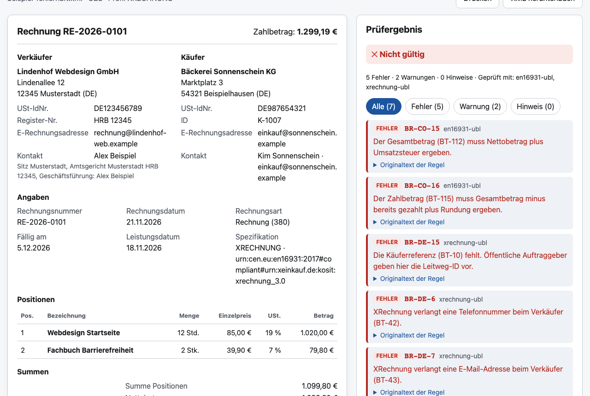

# E-Rechnung Kit

[](https://github.com/tirlogy/einvoice-kit/actions/workflows/ci.yml)
[](README.md#quality)
[](LICENSE)
[](CHANGELOG.md)

ZUGFeRD- und XRechnung-Dateien im Browser anzeigen, prüfen, erstellen und konvertieren. Als npm-Paket und Web-App, ohne dass eine Rechnung das Gerät verlässt.

Demo: [erechnung.tiryaki.eu](https://erechnung.tiryaki.eu) (Vorschau: `build.einvoice-kit.pages.dev`) · [English README](README.md)



## Funktionen

- **Anzeigen**: ZUGFeRD/Factur-X-PDF (eingebettetes XML wird ausgelesen) oder XRechnung (CII und UBL) als gut lesbare, druckbare Rechnung.
- **Prüfen**: offizielle Regelwerke EN 16931 1.3.17 und XRechnung 3.0.2 (Schematron 2.6.0), im Browser mit SaxonJS. Fehler mit Regel-ID, Fundstelle und verständlicher Erklärung auf Deutsch, Englisch und Türkisch. Hinweis, wenn ein Profil (MINIMUM, BASIC WL) in Deutschland nicht als E-Rechnung gilt. Zusätzliche Plausibilitätsprüfungen (IBAN, Leitweg-ID, USt-IdNr., Datum).
- **Erstellen**: Formular mit Live-Vorschau, Download als ZUGFeRD EN 16931 (PDF/A-3b, zwei Layouts, Logo) oder XRechnung CII/UBL.
- **Konvertieren**: XRechnung (CII/UBL) ↔ ZUGFeRD EN 16931, CII ↔ UBL.
- **Sonderfälle**: Kleinunternehmer § 19 UStG, 19 % und 7 %, Reverse Charge § 13b UStG, innergemeinschaftliche Lieferung, Rabatte und Zuschläge, Anzahlungs-, Teil- und Schlussrechnung, Gutschrift, Storno, Rechnungskorrektur, Leitweg-ID.
- **Lokal speichern**: Absender, Kunden und Artikel in IndexedDB, Export/Import als JSON, „Alle Daten löschen“. Rechnungen werden nie gespeichert.

## Schnellstart

```bash
corepack enable
pnpm install
pnpm rules                 # offizielle Regelwerke und Testdateien laden
pnpm --filter web dev      # http://localhost:5173
pnpm test                  # Unit-Tests
```

Bibliothek: siehe [packages/einvoice/README.md](packages/einvoice/README.md).

## Kosten

0 € laufende Kosten: statische Seite auf Cloudflare Pages (Free), GitHub Actions für öffentliche Repos, keine Server, keine Datenbank. Details zu den Free-Tier-Grenzen im [englischen README](README.md#free-tier-limits).

## Qualität

353 Unit-Tests (98,6 % Zeilenabdeckung), 135 offizielle Testdateien, KoSIT-Validator und veraPDF in der CI, Playwright-E2E mit axe-Barrierefreiheitsprüfung und Netzwerk-Datenschutztest, Lighthouse mobil Performance 0,96 bis 0,98 und Barrierefreiheit 1,0. Entscheidungen in [docs/adr](docs/adr).

## Lizenz

[MIT](LICENSE) · Drittanbieter: [THIRD_PARTY.md](THIRD_PARTY.md)

Built by Ömer Tiryaki · [tiryaki.eu](https://tiryaki.eu)
