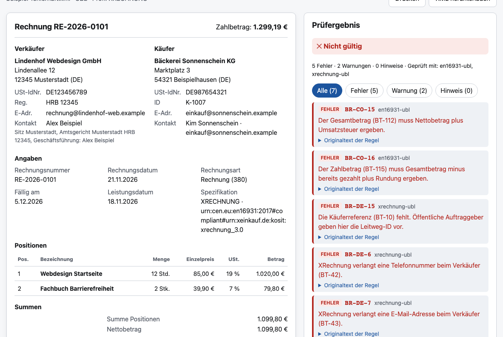
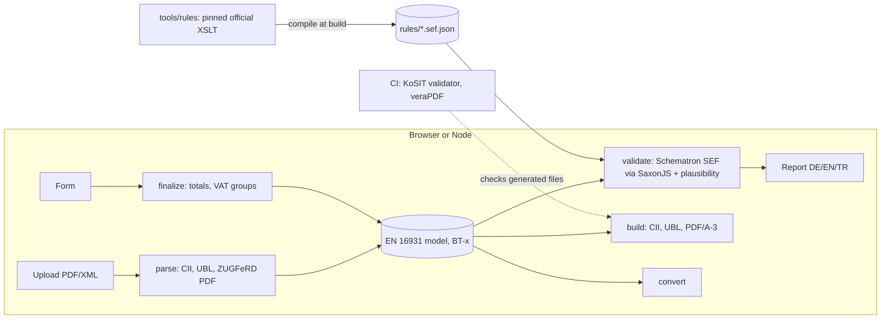
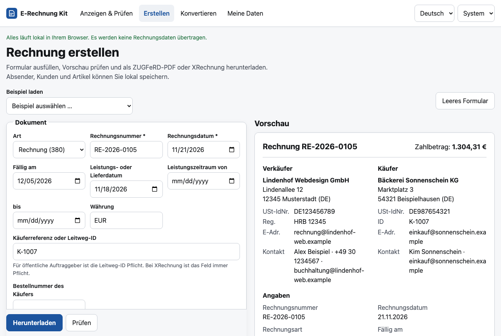
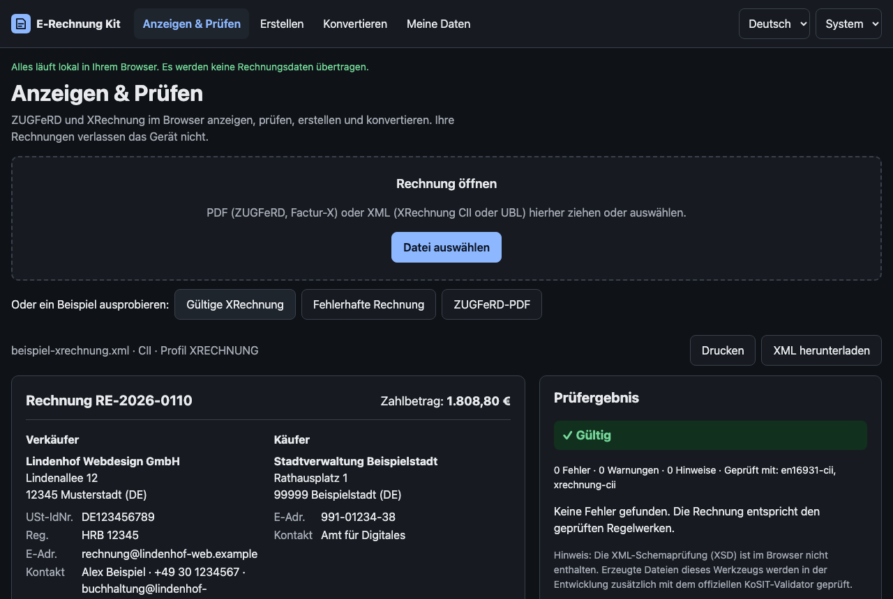
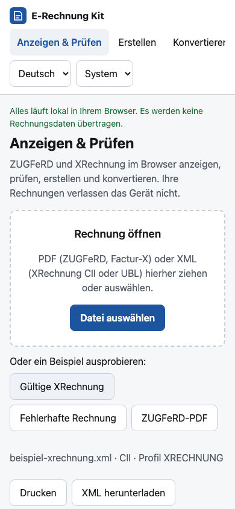

# E-Invoice Kit (E-Rechnung Kit)

[](https://github.com/tirlogy/einvoice-kit/actions/workflows/ci.yml)
[](#quality)
[](LICENSE)
[](CHANGELOG.md)
[](packages/einvoice/README.md)

View, validate, create and convert **ZUGFeRD** and **XRechnung** e-invoices in the browser. Available as an npm package and a web app; invoices never leave the device.

**[Deutsche Kurzfassung](README.de.md)** · Demo: [erechnung.tiryaki.eu](https://erechnung.tiryaki.eu) (preview: `build.einvoice-kit.pages.dev`)



## Why

Since 2025 every business in Germany must be able to receive e-invoices; sending becomes mandatory in 2027/2028. Small businesses and freelancers need a simple tool that does not upload invoices to someone else's server. This kit checks invoices with the **official** rule sets (EN 16931 by CEN/TC 434, XRechnung by KoSIT) directly in the browser and creates valid ZUGFeRD and XRechnung files.

## Features

- **View**: open ZUGFeRD/Factur-X PDFs (embedded XML is extracted) or XRechnung XML (CII and UBL) and read them as a clean, printable invoice. Embedded attachments can be downloaded.
- **Validate**: EN 16931 1.3.17 and XRechnung 3.0.2 Schematron (2.6.0), compiled to SEF and executed with SaxonJS in the browser. Errors and warnings with rule ID, location and a plain language explanation in German, English and Turkish. Clear notice when a profile (MINIMUM, BASIC WL) does not count as an e-invoice in Germany. Extra plausibility checks (IBAN, Leitweg-ID, VAT ID, dates).
- **Create**: form with live preview, download as ZUGFeRD EN 16931 (PDF/A-3b, two layouts, logo, accent colour, DE/EN/TR) or XRechnung CII/UBL.
- **Convert**: XRechnung (CII/UBL) ↔ ZUGFeRD EN 16931, CII ↔ UBL.
- **Special cases**: small business § 19 UStG, 19 % and 7 %, reverse charge § 13b UStG, intra-community supply, allowances and charges on line and document level, prepayment, partial and final invoice, credit note, cancellation, corrected invoice, Leitweg-ID for public buyers.
- **Local data**: senders, customers and articles in IndexedDB, JSON export/import, "delete all". Invoices themselves are never stored.
- PWA (offline after first use), dark and light mode, WCAG 2.1 AA, German, English and Turkish UI.

## Architecture



| Part | Path | What it does |
|---|---|---|
| Library | `packages/einvoice` | model, parsers, builders, validation, conversion. No UI, runs in Node and browsers. Published as `@tirlogy/einvoice`. |
| Web app | `apps/web` | Vite, React API with Preact runtime, TypeScript strict. Static, deployed to Cloudflare Pages. |
| Rule toolchain | `tools/rules` | downloads pinned official artefacts (SHA-256 verified), compiles XSLT to SEF, fetches test fixtures. |
| CI tools | `tools/ci` | KoSIT validator and veraPDF checks for generated files. |
| Decisions | `docs/adr` | 11 architecture decision records. |

## Quick start

Requirements: Node 22+, pnpm (via `corepack enable`). Java and Docker only for the optional conformance checks.

```bash
corepack enable
pnpm install
pnpm rules                 # official rules + test fixtures (downloads ~25 MB once)
pnpm --filter web dev      # http://localhost:5173
```

Tests and checks:

```bash
pnpm test                  # unit tests (library + web)
pnpm coverage              # library coverage, gate 80 %
pnpm lint && pnpm typecheck
pnpm --filter web build && pnpm e2e   # Playwright E2E incl. axe and privacy test
node tools/rules/build.mjs --kosit && node tools/ci/kosit.mjs   # KoSIT validator (Java)
tools/ci/verapdf.sh                                            # PDF/A-3b (Docker)
```

Use the library:

```ts
import { parseInvoice } from '@tirlogy/einvoice';
import { validateFile } from '@tirlogy/einvoice/node';

const { invoice } = await parseInvoice(bytes);
const report = await validateFile('xrechnung.xml');
```

More examples in [packages/einvoice/README.md](packages/einvoice/README.md).

## Configuration

The app needs no configuration. Optional settings:

| Setting | Where | Purpose |
|---|---|---|
| `tools/rules/versions.json` | repo | pinned versions and SHA-256 of EN 16931, XRechnung, KoSIT, SaxonJS |
| `EINVOICE_RULES_DIR` | env (Node) | alternative directory with `*.sef.json` for `@tirlogy/einvoice/node` |
| `CLOUDFLARE_API_TOKEN`, `CLOUDFLARE_ACCOUNT_ID` | GitHub secrets | enable the preview deploy job |
| `apps/web/public/_headers` | repo | security headers (CSP, HSTS, ...) on Cloudflare Pages |

Updating the official rules: `node tools/rules/build.mjs --check-updates`, edit `versions.json`, `node tools/rules/build.mjs --pin`, run the tests.

## Free tier limits

Running costs are 0 €. The app is a static site with no backend.

| Service | Free tier | Usage here |
|---|---|---|
| Cloudflare Pages | unlimited requests and bandwidth for static assets, 500 builds/month, 20,000 files, 25 MiB per file | ~25 files, largest file 6.8 MB (UBL rules, 190 KB compressed); deploys via direct upload from CI |
| GitHub Actions | free for public repositories | 3 jobs per push, ~6 minutes |
| npm | free for public packages | `@tirlogy/einvoice` |

No Workers, databases or KV are used, so there is nothing that can run over a limit.

## Quality

- TypeScript `strict`, ESLint (typescript-eslint, react-hooks, jsx-a11y)
- 353 unit tests for the library (98.6 % lines, 97.4 % statements, 84 % branches), coverage gate 80 % in CI, plus web unit tests
- 135 official test files read; all valid ones produce zero errors; CII → UBL → CII roundtrip without loss of mandatory fields
- Every special case is validated by the KoSIT validator (XSD + Schematron) and every generated PDF by veraPDF (PDF/A-3b) in CI
- Playwright E2E on desktop and mobile: create → download → re-open → valid; axe WCAG 2.1 AA in light and dark mode; network test that fails if any request carries invoice data
- Lighthouse mobile (local runs): performance 0.98 (viewer) / 0.96 (editor), accessibility 1.0, best practices 1.0, SEO 1.0

## Screenshots

| Create with live preview | Dark mode | Mobile |
|---|---|---|
|  |  |  |

## Privacy

No backend, no cookies, no tracking. CSP `connect-src 'self'`. See [ADR 0011](docs/adr/0011-privacy-by-architecture.md) and the in-app privacy page.

## License

[MIT](LICENSE) © Ömer Tiryaki. Third-party components and rule sets: [THIRD_PARTY.md](THIRD_PARTY.md) (EN 16931 artefacts EUPL-1.2, XRechnung Apache-2.0, SaxonJS under the Saxonica license, Open Sans Apache-2.0).

Built by Ömer Tiryaki · [tiryaki.eu](https://tiryaki.eu)
