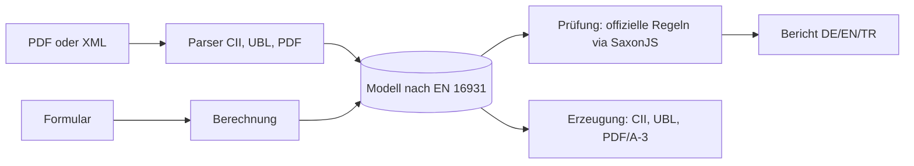

# E-Rechnung Kit

## Problem

Seit Januar 2025 müssen Unternehmen in Deutschland E-Rechnungen empfangen können, ab 2027 bzw. 2028 auch versenden. Eine E-Rechnung ist kein PDF mehr, sondern strukturierte Daten nach der europäischen Norm EN 16931: entweder als XRechnung (reines XML, in zwei Syntaxen CII und UBL) oder als ZUGFeRD, also ein PDF/A-3 mit eingebettetem XML.

Kleine Firmen und Selbstständige stehen damit vor drei Fragen:

1. Was steht in der XML-Datei, die mir ein Lieferant geschickt hat?
2. Ist sie gültig, und wenn nicht, was genau ist falsch?
3. Wie erstelle ich selbst eine gültige E-Rechnung, ohne teure Software?

Die offiziellen Prüfwerkzeuge (KoSIT-Validator) laufen in Java auf der Kommandozeile. Viele Online-Prüfer laden die Rechnung auf einen fremden Server hoch, was bei Rechnungen mit Bank- und Kundendaten heikel ist.

## Lösung

Ein Werkzeug, das alles im Browser erledigt und gleichzeitig als npm-Paket für Entwickler nutzbar ist:

- **Anzeigen**: PDF oder XML hochladen, die eingebettete Rechnung wird ausgelesen und als druckbare Rechnung dargestellt.
- **Prüfen**: mit den offiziellen Regelwerken EN 16931 (CEN/TC 434) und XRechnung (KoSIT), nicht mit nachgebauten Regeln. Jeder Fehler kommt mit Regel-ID, Fundstelle und einer verständlichen Erklärung auf Deutsch, Englisch oder Türkisch.
- **Erstellen**: Formular mit Live-Vorschau, Download als ZUGFeRD-PDF (PDF/A-3b) oder XRechnung. Alle deutschen Sonderfälle sind abgedeckt: Kleinunternehmer, 19 % und 7 %, Reverse Charge, innergemeinschaftliche Lieferung, Rabatte, Anzahlungs- und Schlussrechnung, Gutschrift, Storno, Leitweg-ID.
- **Konvertieren**: XRechnung in ZUGFeRD und zurück, CII in UBL und zurück.

Keine Rechnung verlässt das Gerät. Das ist nicht nur versprochen, sondern technisch erzwungen (Content Security Policy) und durch einen automatischen Test belegt, der jede Netzwerkanfrage mitschneidet.

## Architektur

Das Herz ist eine framework-freie TypeScript-Bibliothek mit einem normierten Rechnungsmodell entlang der Business Terms der EN 16931 (BT-1 Rechnungsnummer bis BT-165). Parser übersetzen CII, UBL und ZUGFeRD-PDF in dieses Modell, Builder erzeugen daraus wieder CII, UBL oder PDF/A-3. Dadurch ist jede Konvertierung nur „einlesen und anders ausgeben“.

Für die Prüfung lädt ein Build-Skript die offiziellen Schematron-Regeln in gepinnten Versionen (mit SHA-256-Prüfsumme), kompiliert sie zu SEF und führt sie im Browser mit SaxonJS aus. Die Web-App ist eine statische Seite auf Cloudflare Pages, ohne Server und ohne Datenbank.

## Stack

TypeScript (strict), React-API mit Preact-Laufzeit, Vite, pdf-lib mit fontkit, SaxonJS, Schematron, big.js, IndexedDB, Vitest, Playwright mit axe, Lighthouse CI, GitHub Actions, Cloudflare Pages.

## Learnings

- **Offizielle Regeln statt Nachbau.** Der Aufwand für die Regel-Toolchain hat sich sofort gelohnt: Die Tests liefen gegen 135 offizielle Testdateien, und alle gültigen ergaben auf Anhieb 0 Fehler. Gegenprobe in der CI mit dem echten KoSIT-Validator und veraPDF.
- **Laufzeiten unterscheiden sich im Detail.** Die Browser-Version von SaxonJS rechnet lange Ganzzahlen nur mit doppelter Genauigkeit. Die IBAN-Prüfung von XRechnung (BR-DE-19) meldete deshalb korrekte IBANs als falsch. Gelöst mit einer eigenen exakten Prüfung, dokumentiert als ADR.
- **PDF/A ist ein Vertrag mit vielen Klauseln.** XMP-Metadaten, Info-Dictionary, OutputIntent mit ICC-Profil, eingebettete Schriften, Datei-ID und die Factur-X-Erweiterung müssen exakt zusammenpassen. veraPDF in der CI macht daraus eine messbare Eigenschaft.
- **Performance ist eine Architekturentscheidung.** Mit React lag die Editor-Seite bei Lighthouse mobil um 0,85. Preact als Laufzeit unter derselben React-API, eine kurz verzögerte Vorschau und konsequentes Nachladen von pdf-lib und Regelwerken brachten 0,96 bis 0,98.
- **Tests finden Doku-Fehler.** Das Beispiel im README läuft als Test. Dabei fiel auf, dass XRechnung die Geschäftsprozess-Kennung (BT-23) verlangt; die Bibliothek setzt sie jetzt automatisch.

## Kennzahlen

| Kennzahl | Wert |
|---|---|
| Offizielle Testdateien gelesen | 135 (KoSIT-Testsuite, EN-16931-Beispiele, ZUGFeRD 2.5.2) |
| Unit-Tests Bibliothek | 353, Abdeckung 98,6 % Zeilen |
| E2E-Tests (Desktop und Mobil) | 38, inklusive axe WCAG 2.1 AA hell und dunkel |
| Sonderfälle mit KoSIT-Validator und veraPDF geprüft | 10 (je CII, UBL, PDF) |
| Lighthouse mobil | Performance 0,98 (Ansicht) und 0,96 (Editor), Barrierefreiheit 1,0 |
| JavaScript beim ersten Laden | 47 KB gzip |
| Regelwerke | EN 16931 1.3.17, XRechnung 3.0.2 (Schematron 2.6.0) |
| Erklärte Regeln | rund 100 einzeln, alle übrigen nach Regelfamilie |
| npm-Paket | 665 KB gepackt, läuft in Node und im Browser |
| Laufende Kosten | 0 € |
